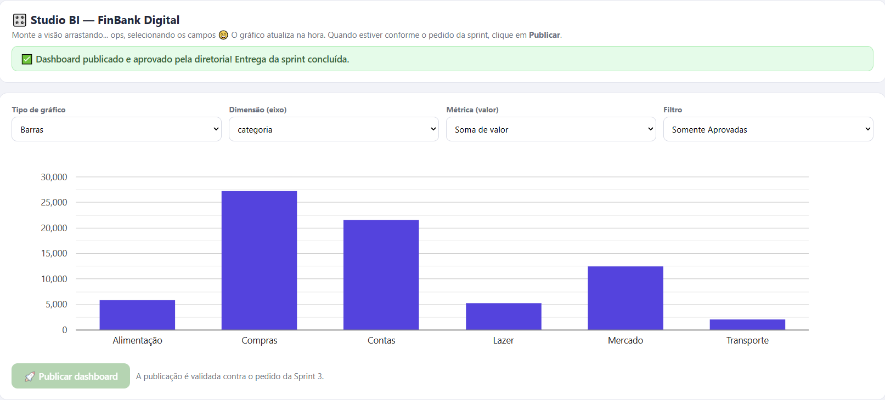

# FinBank Digital — Análise de Dados e Scrum

Projeto educacional desenvolvido durante uma simulação corporativa no DataCorp Simulator.

## Objetivo
Analisar transações financeiras, identificar problemas de qualidade dos dados, investigar indicadores de risco e apresentar informações para apoiar decisões de negócio.

## Tecnologias e competências
- Python
- Análise e tratamento de dados
- Business Intelligence
- Visualização de dados
- Metodologia ágil Scrum

## Atividades realizadas
- Identificação de registros duplicados e dados ausentes
- Cálculo de indicadores financeiros
- Análise de transações suspeitas
- Investigação de regras antifraude em ambiente Linux simulado
- Construção de dashboard de BI
- Elaboração de relatório executivo

## Resultados da simulação
- 3 etapas concluídas
- 12 desafios finalizados
- 10 conquistas obtidas

## Organização
- notebooks/: análises em Python
- dashboards/: imagens e visualizações
- relatorios/: relatório executivo

## Dashboard de Business Intelligence

Dashboard desenvolvido no Studio BI do DataCorp Simulator, durante a simulação FinBank Digital.

**Configuração:**
- Tipo: gráfico de barras
- Dimensão: categoria
- Métrica: soma dos valores
- Filtro: somente transações aprovadas

### Principais observações

As categorias Compras e Contas apresentaram os maiores volumes financeiros em valores aprovados.

O dashboard foi publicado e aprovado na Sprint 3 da simulação.

## Observação
Este é um projeto educacional baseado em uma simulação corporativa, não uma experiência profissional em uma instituição financeira real.